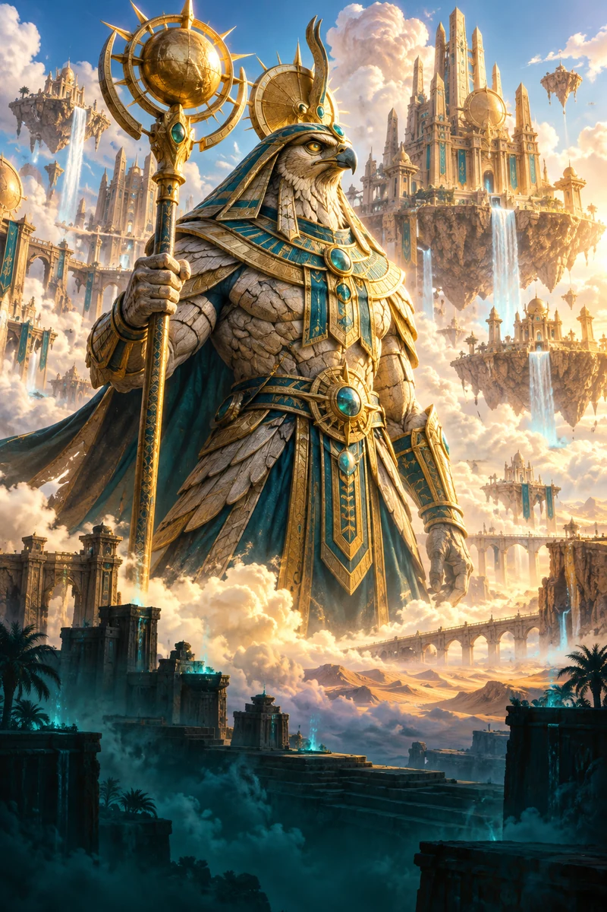

# 圖片與圖示資產

沙海神殿盤面的 11 種符號已另以透明 WebP 全面更新，完整 prompt、原始 PNG、輸出尺寸與雜湊見 [盤面符號資產](storm-symbol-assets.md)。

免費回合使用獨立透明鳥神、無杖修補底圖與神殿背景播放揮杖攻擊及分層動畫，完整 prompt、WebP 路徑與行為見 [免費回合鳥神動畫](storm-guardian-animation.md)。

## 沙海神殿大廳海報

- 日期：2026-10-24。
- 概念依據：既有 `storm-temple.webp` 的沙漠浮空神殿、金色建築、青綠護甲、隼首石質守衛與日輪權杖。
- 生成方式：built-in `image_gen`；原創場景，沒有下載參考遊戲的美術。
- 專案檔案：[`storm-demo.webp`](../apps/web/public/images/games/storm-demo.webp)。
- 原始 PNG：`/Users/k/.codex/generated_images/01a16bf5-65ca-7e82-9483-a367b1cd23c5/exec-296eaf1e-7ff9-40c1-b60a-c71df83d7a72.png`，1024 × 1536；原檔保留於本機。
- 交付尺寸：800 × 1200，WebP quality 88、method 6；使用 Pillow Lanczos 縮圖。
- WebP 大小：250,526 bytes（約 245 KiB）；SHA-256：`87746a37fc5020133933c2bcbd9e15ea73c54f6d468b1c2b1ba6787e2b1b34c7`。
- 使用位置：`LobbyView.vue` 第六張遊戲卡，`/images/games/storm-demo.webp`。
- 圖片不含文字；遊戲標題、入口及 accessible name 由 HTML 提供，避免重複文字與縮圖後字形失真。



### 完整生成 prompt

```text
Use case: stylized-concept
Asset type: original fantasy browser game lobby poster, portrait 2:3, 1024 x 1536.
Primary request: Create a premium original cover illustration for the game's established 'Sand Sea Temple' concept. A majestic falcon-headed stone guardian with teal and burnished gold armor and a sun-disc staff stands centrally in the upper two thirds, in front of monumental golden sandstone floating temples above a desert sea and luminous clouds. Detailed sculpted stone feathers, geometric gold inlay, turquoise gemstone accents; believable polished fantasy game key art, rich depth and atmospheric light.
Composition: centered readable silhouette, head and sun-disc comfortably inside the frame, dramatic low angle, temple architecture framing the guardian. Keep the lower 28 percent low detail, dark teal and warm shadowed stone for separate white HTML title and entry action. Illustration fills the frame, no drawn UI frame. Existing visual concept is blue sky, golden sunlight, cloud sea, desert floating temples, falcon-headed guardian, teal/gold armor.
Lighting: luminous warm sunlight and subtle turquoise magical highlights, deep elegant teal shadows, detailed painterly cinematic 3D finish.
Text: none.
Constraints: completely original character and architecture; no letters, typography, Chinese characters, logos, watermark, UI, cards, emojis, flat vector outlines, or resemblance to an existing commercial game character.
```

## 全站圖示規範與掃描

UI 不使用 emoji、顏文字或一般文字字型的裝飾字元代替圖示。這次掃描所有 `apps/web/src`、`apps/web/public`、PWA 與 HTML，檢查 Unicode pictograph、variation selector、文字圖示、HTML entity、Unicode escape 及常見顏文字。

- 原本用文字字元呈現的關閉、勾選、跳牌、旋轉、停止、播放、快速模式、音效、外連箭頭、裝飾、加減按鈕及四種撲克牌花色，改由原創自託管 icon font 呈現。
- 涵蓋大廳、沙海神殿、Hi-Lo、Blackjack、百家樂牌桌／投注紀錄／規則、Mines、Plinko，以及 StakeControl、WinCelebration。
- 數學比較、倍率、無限、狀態文字中的標點保留其文字語意；既有 SVG 遊戲美術與 SVG 控制圖示不是 emoji，沿用原有資產。
- Icon 使用 Private Use Area，沒有系統 emoji fallback 或外部 CDN。按鈕保留文字或 `aria-label`；裝飾 icon 設為 `aria-hidden`。花色由 `CardSuit` 提供中文 accessible label。

### 可維護來源

- `apps/web/src/components/ui/AppIcon.vue`：依名稱使用 font icon，尺寸為 1em，顏色繼承 currentColor。
- `apps/web/src/components/ui/CardSuit.vue`：S／H／D／C 與花色 icon、無障礙名稱對應。
- `apps/web/src/assets/ui-icons.json`：19 個原創 24 × 24 填色輪廓，包含自動模式使用的 `infinity`；沒有第三方圖示授權相依。
- `scripts/build-ui-icons.py`：產生 `src/assets/ui-icons.woff2` 與 `src/lib/ui-icons.ts`。FontTools 只在重建字型時需要，不增加瀏覽器或 npm runtime 相依。

重建指令：

```sh
python3 -m venv /tmp/playground-icon-font-venv
/tmp/playground-icon-font-venv/bin/pip install 'fonttools[woff]==4.60.2'
/tmp/playground-icon-font-venv/bin/python scripts/build-ui-icons.py
npx prettier --write apps/web/src/lib/ui-icons.ts
```

新增 icon 時在 JSON 末尾追加，以保留既有 Private Use Area 對應。此 WOFF2 小於 Vite 的內嵌門檻，production build 直接打包進 CSS，圖片位於 public。此修改只影響顯示資產，不改 API、遊戲結果、金額或機率。

## 圖片與圖示替換階段的驗證

- 靜態掃描：前端 source、public（含 SVG）、PWA 與 HTML 已無本次掃描涵蓋的 emoji、顏文字或文字裝飾圖示；舊 SVG 海報來源中的花色文字也改成明確 path。
- 167 項 Vitest 與 12 項 Node 檢查通過。舊 accessibility 檢查原先要求文字箭頭，更新為 icon 後，相關 10 項重新通過。
- `npm run typecheck --workspace web`、`npm run build --workspace web`、變更前端與 E2E 檔案的 ESLint、Prettier 及 `git diff --check` 通過。E2E 檔案原本沒有 ESLint matching configuration，另以相同 TypeScript recommended rules 臨時設定檢查，沒有將 ignored 警告當作通過。
- 分批完成 35 個 browser cases：跨 Chromium／WebKit 的 viewport 22 項、Hi-Lo／Blackjack 4 項，加上 Chromium 大廳 1 項、展示頁 3 項、直式／長數字 5 項。涵蓋 320×568、390×844、483×771 等尺寸、按鈕操作、對話框、牌序與 reduced motion。
- 大廳舊測試預期含文字箭頭及 SVG 檔名，更新後重跑通過。直式截圖測試原先會錯過短暫的 clearing 階段，改由 Playwright Clock 暫停時間、逐階段推進後，四尺寸全部通過；沒有調整產品動畫或遊戲規則。
- 實際瀏覽器確認 `storm-demo.webp` 解碼為 800×1200，`Casino UI Icons` font 已載入；另目視檢查大廳與兩種牌面遊戲截圖。
- 此階段 E2E 使用 mocked API；當時尚未接入交易後端。後續真實 PostgreSQL／WS 與帳戶整合驗證見 [沙海神殿](storm-demo.md)。Build 有既有 PWA `inlineDynamicImports` 棄用警告。

大廳實際截圖保留在本機 `test-results/lobby-icon-final/lobby-carousel-lobby-cente-8d9b6-and-opens-the-selected-game-chromium/storm-lobby.png`。

## Icon font 對齊修正（2026-10-24）

字型重建時保留每個輪廓的實際 `xMin` 作為 left side bearing，不再全部設為 0；同時統一 hhea／OS/2 的垂直 metrics。這修正了旋轉、播放、加減與快速圖示的水平偏移。沙海神殿按鈕另以明確 icon 大小與 flex 對齊；549×761 與手機各尺寸截圖已核對。圖片生成檔與 prompt 維持以上紀錄；目前遊戲的後端接入狀態見 [沙海神殿](storm-demo.md)。
